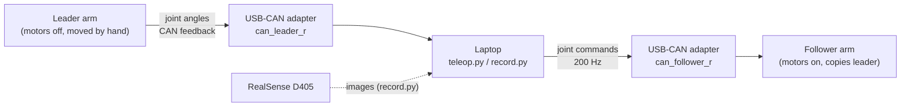

# Piper-X Leader–Follower Teleoperation

Teleoperate an AgileX **Piper-X** arm with a second Piper-X held by hand, and record demonstrations as a [LeRobot](https://github.com/huggingface/lerobot) dataset for imitation learning (ACT, diffusion policy, flow matching, …).

**Robot Perception & Learning (RPL) Lab, IIT Bombay** · maintained by Priya Biswas

Current status: **left pair working.** Right pair connected (via USB hub), being set up.

---

## How it works



- Each arm has **its own USB‑CAN adapter**, so the two arms can't talk to each other directly. The laptop reads the leader and commands the follower.
- **Both arms stay in factory default mode.** Do **not** run `MasterSlaveConfig`; see [Notes](#notes).
- **Leader: Teaching Input Arm** (AgileX's recommended setup). Set it once in AgileX's PC software: connect **only the leader**, **Linkage tab → Leader → ok** (offsets 0x00), then power‑cycle it. It is then free to move by hand and sends its joint and gripper positions (CAN 0x155–0x157, 0x159). **It only sends while it is moving**, so at startup the scripts ask you to move it a little. Do not press its teach button. (Fallback: leave it in normal mode and single‑click the teach button for drag mode; the scripts detect either.)
- **Follower: Linkage → Follower** (normal mode), **teach button never pressed.** It is enabled by the laptop and receives the leader's pose about 200 times a second. In teaching mode it would ignore those commands.
- Short‑pressing the teach button again exits teaching mode. Power‑cycling an arm also resets it to normal mode.
- ⚠️ **Never double‑click the teach button.** A double‑click starts **playback**: the arm replays a recorded drag trajectory and moves on its own.
- **Gripper (0–100 mm, large gripper):** the follower gripper **follows the leader's teaching pendant** by default (`--gripper leader`, read from the leader's CAN 0x159). Use `--gripper-scale` if the pendant's travel doesn't map 1:1 onto 0–100 mm, or `--gripper keyboard` to drive it from keys instead. Grip force: `--gripper-effort` in N·m (0–5, default 1.0). The follower gripper needed a firmware update on node 0007 (done 2026‑10‑08); until the pendant is confirmed working on both pairs, test with `tools/gripper_debug.py <follower> --test`.

> **What is CAN?** Controller Area Network: a 2‑wire bus, originally from cars, that the Piper's motors and controller use to exchange short messages ("joint 3 is at 42.1°", "move joint 3 to 45°"). The USB‑CAN adapter makes it appear in Linux as a network interface (like `can0`).

---

## Hardware

| Item | Qty | Notes |
|---|---|---|
| AgileX Piper‑X arm | 2 per pair | 1 leader + 1 follower |
| USB‑CAN adapter (ships with arm) | 1 per arm | |
| RealSense D405 | 1+ | only needed for recording |
| Ubuntu laptop | 1 | tested on Ubuntu, Python 3 |

### Verified port map

The USB port decides which interface is which arm. **Always plug each adapter into the same port.**

| Interface name | USB port (bus‑info) | Arm | Verified |
|---|---|---|---|
| `can_leader_l` | `3-4.2:1.0` (hub on 3-4) | left leader | 2026‑10‑10, laptop `priyas-Victus` |
| `can_follower_l` | `3-4.1:1.0` (hub on 3-4) | left follower | 2026‑10‑10, laptop `priyas-Victus` |
| `can_leader_r` | `3-4.3:1.0` (hub on 3-4) | right leader | 2026‑10‑08, laptop `priyas-Victus` |
| `can_follower_r` | `3-4.4:1.0` (hub on 3-4) | right follower | 2026‑10‑08, laptop `priyas-Victus` (moved from hub socket 3-4.2) |

If you use a different laptop or different ports, redo [step 3](#3-identify-which-adapter-is-which-arm) and update this table and `scripts/setup_can.sh`.

---

## Setup (first time)

### 1. Install

```bash
sudo apt update && sudo apt install -y can-utils ethtool
git clone <this-repo-url> piper-teleop && cd piper-teleop
pip3 install -r requirements.txt
```

`python` not found? Use `python3`, or run `sudo apt install python-is-python3`.

### 2. Plug in and check that both adapters are detected

Power both arms, plug both adapters into the laptop, then:

```bash
bash scripts/setup_can.sh --find
```

Expected output: one line per adapter, e.g.
```
Interface can0 is connected to USB port 3-1:1.0
Interface can1 is connected to USB port 3-2:1.0
```

### 3. Identify which adapter is which arm

Bring both buses up under their default names:
```bash
SDK=$(python3 -c "import piper_sdk,os;print(os.path.dirname(piper_sdk.__file__))")
bash $SDK/can_activate.sh can0 1000000 "3-1:1.0"
bash $SDK/can_activate.sh can1 1000000 "3-2:1.0"
```
Run `candump can0` and then `candump can1`. Frames should scroll on each; stop each with Ctrl+C. If one shows nothing, that arm is off or unplugged.

Now find the leader:
```bash
python3 tools/check_joints.py can0
```
Short‑press the **teach button on the leader** (teaching mode ON), then **while it prints, move the leader arm by hand.**
- Numbers change: that port is the leader.
- Numbers don't change: run the same command on `can1`.

Write the result in the [port map](#verified-port-map) and in `PORTS=(...)` at the top of `scripts/setup_can.sh`.

### 4. Bring up the interfaces with fixed names

```bash
bash scripts/setup_can.sh
```
This renames the adapters to `can_leader_r` / `can_follower_r` based on their USB ports, so they can't swap after a reboot. **Run it after every boot, re‑plug, or arm power‑cycle.** Plug each adapter **directly into the laptop**, not through a USB hub: a hub that disconnects takes the adapters with it, and their port numbers change.

Check:
```bash
python3 tools/check_joints.py can_leader_r     # move leader → numbers change
python3 tools/arm_status.py can_leader_r can_follower_r   # leader: drag mode FREE; follower: NOT teaching mode
```

### 4b. Leader assist (makes the leaders lighter to move)

Each leader has a per‑joint **assist level** 0–10 stored on the arm (0 = off, the factory value). The lab uses:

| Joint | J1 | J2 | J3 | J4 | J5 | J6 |
|---|---|---|---|---|---|---|
| Level | 3 | 6 | 6 | 3 | 3 | 3 |

Set on `can_leader_l` and `can_leader_r` on 2026‑10‑08. Leaders only; never the followers. Teleop must not be running.

```bash
# read (reply 0x488 = J1..J6 levels)
timeout 1 candump can_leader_l,488:7FF & sleep 0.2; cansend can_leader_l 477#0500000003000000; wait
# set J1..J6 = 3,6,6,3,3,3    (hold the leader: too much assist makes it lift or drift on its own)
cansend can_leader_l 487#0306060303030000
# all off
cansend can_leader_l 487#0000000000000000
```
Too strong (arm lifts/drifts when let go) → lower J2/J3. A joint that wanders (J1/J6 carry no weight) → set it to 0.

### 5. First teleop test

1. Put the follower on a clear table. Keep the e‑stop within reach.
   Leader set as Teaching Input Arm, follower as Follower, teach buttons not pressed.
2. Hold the leader in roughly the **same pose** as the follower.
3. Run:
   ```bash
   python3 teleop.py --speed 30
   ```
4. When it prints `MOVE THE LEADER A LITTLE`, move the leader gently: it only sends data while moving. The follower then moves **slowly** (15 %) toward the leader. When every joint is within 5°, it prints `synced` and switches to the `--speed` you set.
5. Move the leader gently. The follower should copy it.
6. Gripper: squeeze / open the leader's teaching pendant and the follower gripper follows (0–100 mm). With `--gripper keyboard`: `o` = open, `c` = close, `[` / `]` = 10 mm less / more.
7. Press Ctrl+C to stop. The follower **holds its pose** and stays powered.

When this is smooth, try the default speed (`python3 teleop.py`, 60 %).

---

## Recording episodes

```bash
python3 -c "from piper_teleop.cameras import list_serials; print(list_serials())"   # camera serials

python3 record.py --repo-id rpl/piper_pick_cube --task "pick up the red cube" \
    --cam wrist=123456789012 --cam top=234567890123
```

| Key (single press) | Action |
|---|---|
| Enter | start episode / stop + save episode |
| `r` | discard current episode |
| `q` | quit |
| `o` / `c` | open / close follower gripper (`--gripper keyboard` only) |
| `[` / `]` | gripper 10 mm less / more (`--gripper keyboard` only) |

With `--gripper keyboard`, the second `--pair` uses `u` / `n` and `{` / `}`.

- You can only start an episode once the pair is `synced`.
- If leader data drops mid‑episode, that episode is discarded automatically.
- Return both arms to the same home pose between episodes.
- Default save location: `~/.cache/huggingface/lerobot/<repo-id>`. Change it with `--root`.

### Dataset format (per frame, 30 fps)

| Key | Shape | Meaning |
|---|---|---|
| `observation.state` | 7 per pair | follower measured: 6 joints [rad] + gripper [m] |
| `action` | 7 per pair | leader joints + gripper command (pendant, or keyboard) = what the follower was told, same units |
| `observation.images.<name>` | H×W×3 | RealSense colour, stored as video |

Names are `right_joint_1 … right_gripper`, plus `left_…` for bimanual.

---

## Safety

- **Keep the follower's e‑stop within reach** every time teleop is running.
- **Only single‑click the teach button.** A double‑click makes the arm replay a recorded trajectory on its own.
- Start new setups at `--speed 30`.
- The sync phase prevents the follower from jumping at startup. Still, start with the arms in similar poses.
- Ctrl+C makes the follower **hold** position. `--disable-on-exit` makes it go limp, and **it will fall**: support it by hand first.
- SDK joint and gripper limits are on for the follower, so commands beyond the safe range are clipped (gripper: 0–100 mm).
- If the leader's CAN data stops (cable pulled, leader powered off), the follower stops receiving commands and holds position.

---

## Adding the second pair (bimanual)

1. Plug in the two new adapters and run `bash scripts/setup_can.sh --find`.
2. Identify leader and follower as in [step 3](#3-identify-which-adapter-is-which-arm).
3. Uncomment and fill in the `can_leader_l` / `can_follower_l` lines in `scripts/setup_can.sh`, and update the port map.
4. Run with both pairs:
   ```bash
   python3 teleop.py --pair right:can_leader_r:can_follower_r --pair left:can_leader_l:can_follower_l
   python3 record.py --pair right:can_leader_r:can_follower_r --pair left:can_leader_l:can_follower_l \
       --repo-id rpl/piper_bimanual_x --task "..." --cam top=...
   ```
Four adapters may need a powered USB hub.

---

## Troubleshooting

| Problem | Fix |
|---|---|
| `Command 'python' not found` | use `python3`, or `sudo apt install python-is-python3` |
| `No data on can_…` | arm powered? adapter plugged into the port in the map? did you run `scripts/setup_can.sh`? |
| `candump` shows nothing | power/cable problem on that arm |
| `CAN socket can_leader_r does not exist` / `Unable to find CAN interface … 3-1:1.0` | the adapter reconnected or isn't on its port. Plug it into its hub socket from the port map, then `bash scripts/setup_can.sh` |
| Wrong arm moves / roles swapped | adapters were plugged into different ports; redo step 3 |
| `waiting for data: MOVE THE LEADER A LITTLE` | normal for a Teaching Input Arm leader: it sends nothing while still. Move it gently |
| Leader disconnects / PC software flips between Connected and Offline | normal for a Teaching Input Arm in AgileX's app (it stops sending status). Use the app only to change settings |
| `No data on can_follower_…` but `candump` shows the follower sending **0x3A0–0x3A7** (not 0x2A1–0x2A8) | the follower's role config is off. `python3 tools/set_role.py <can> follower` (sends only 0x470 `FC 00 00 00`), power‑cycle the follower, `bash scripts/setup_can.sh`. Fixed the left follower on 2026‑10‑08 |
| `Follower … did not enable` | release the e‑stop, power‑cycle the follower, try again |
| Follower enabled but doesn't move | it is in teaching mode: short‑press its teach button, or power‑cycle it |
| Leader stiff, can't move it by hand | leader is not in drag mode. The teach button toggles drag ON (`START_RECORDING`, free) / OFF (`STOP_RECORDING`, holds pose). Short‑press it and check with `tools/arm_status.py` |
| Leader joints or gripper **locked** | a teach‑button press ended drag mode (`STOP_RECORDING`). Short‑press the teach button again. If `arm_status.py` ever shows the leader in `CAN_CTRL`, the adapters are swapped: check the port map |
| Leaders feel heavy | raise the leader assist levels, see [4b](#4b-leader-assist-makes-the-leaders-lighter-to-move) |
| Follower gripper doesn't follow the pendant | check the leader sends 0x159 while you squeeze the pendant (e.g. `candump can_leader_l,159:7FF`). If its range is short (e.g. 0–70), use `--gripper-scale 1.43`. Fall back to `--gripper keyboard` |
| Follower shows `TEACHING_MODE` | power‑cycle it and don't press its teach button. Teleop refuses to start until it is out of teaching mode |
| Follower never prints `synced` | move the leader closer to the follower's pose |
| Follower jerky or laggy | lower `--speed`, close other heavy programs, check `Hz` column in `tools/check_joints.py` (~200 expected) |
| `ModuleNotFoundError: piper_sdk` | `pip3 install -r requirements.txt` |
| LeRobot import/API error | note your `lerobot` version (`pip3 show lerobot`); `record.py` handles old and new APIs, but the API changes often |

---

## Notes

- **Why not the Piper's built‑in master/slave mode?** That mode (`MasterSlaveConfig(0xFA/0xFC)`) needs the leader and follower on the **same** CAN bus, with no laptop in between. Our arms each have their own adapter, so the laptop does the forwarding. This also gives us software speed limits, a sync phase and stale‑data protection. If an arm was ever set to master/slave mode, reset it to default before using this repo.
- SDK units: joints are 0.001°, gripper 0.001 mm. Recorded data is converted to rad and m.

## Repo layout

```
piper-teleop/
├── teleop.py               # leader -> follower, no recording
├── record.py               # teleop + record LeRobot dataset
├── piper_teleop/
│   ├── arms.py             # Leader, Follower, TeleopPair, Bridge (200 Hz thread)
│   ├── cameras.py          # RealSense reader
│   └── keyboard.py         # single-key input, gripper keys
├── scripts/setup_can.sh    # bring up CAN interfaces with fixed names
├── tools/check_joints.py   # read-only joint printer for debugging
├── tools/arm_status.py     # read-only: each arm's mode in plain words
├── tools/set_role.py       # optional: set built-in leader/follower role (0xFA/0xFC)
├── tools/leader_gripper_test.py  # checks whether the leader gripper can be moved by hand
├── tools/leader_diag.py    # read-only: which CAN frames the leader sends (still vs moving)
├── tools/which_arm.py      # listen-only: move one arm, see which CAN interface it is
├── tools/gripper_debug.py  # gripper status / test with piper_sdk
├── tools/agx_gripper_official.py # gripper status / calibrate / test with AgileX's pyAgxArm
└── requirements.txt
```
